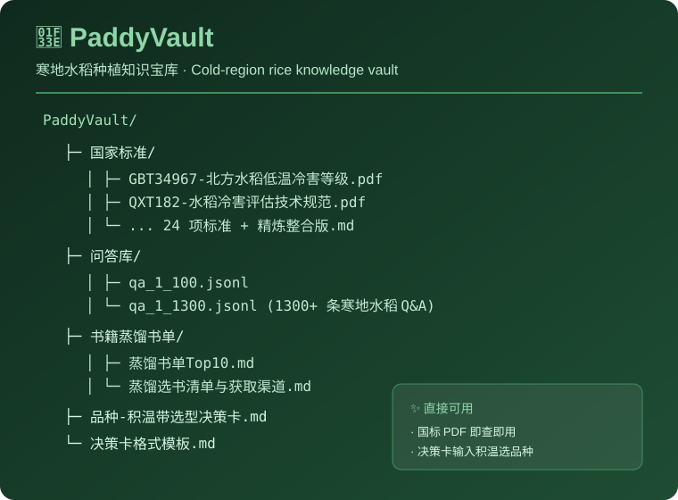

# 🌾 PaddyVault

> 寒地水稻种植知识宝库 —— 国家标准 + 决策卡 + 书籍蒸馏 + 千条问答 一站式资料库
> 面向东北寒地稻作区，从「选种 → 种植 → 防害 → 收获 → 储存」全链条可检索知识资产。

[English](README.en.md) · [Changelog](CHANGELOG.md)

---

<p align="center">
  
</p>

## 🌟 为什么是 PaddyVault？

东北寒地水稻种植，靠的是"细节"——差一个积温带、差一个冷害等级、差一个国家标准，结论就错。但相关资料散落在 PDF、旧书籍、碎片问答里，找起来极其痛苦。

**PaddyVault 把散落的知识收进一座「宝库」**：精选国家标准、品种选型决策卡、经典书籍蒸馏书单、千条实战问答，按「直接可用」的原则组织——每一份资料都能在田间地头、知识库检索里真正用上。

---

## ✨ 特色与亮点

- **国家标准全覆盖**：水稻相关现行国家标准 / 行业标准 / 地方标准精选合集（PDF），含冷害等级、品质判定、种子检疫、生产技术规程等核心规范。
- **决策卡，直接可用**：把"品种 × 积温带 × 盐碱地 × 官方主推"的选型逻辑蒸馏成可执行判定规则，输入地块积温就能匹配品种。
- **书籍蒸馏书单**：从经典水稻书籍中蒸馏出的 Top10 书单 + 获取渠道，避免在旧书堆里浪费时间。
- **千条实战问答**：1300+ 条寒地水稻 Q&A（jsonl），覆盖育秧、施肥、防害、节水灌溉等高频问题，可直接喂给 RAG 知识库。
- **检索友好**：问答库与决策卡均带结构化标签 / 触发词 / 数据来源，适合接入大模型知识库做精准召回。
- **持续沉淀**：随水稻知识库扩容同步更新（当前决策卡、书单、国家标准持续补充中）。

---

## 📦 内容结构

| 目录 | 内容 | 说明 |
|---|---|---|
| **国家标准/** | 水稻国家标准 / 行业标准 / 地方标准 PDF + 知识库配置 | 冷害、品质、检疫、生产技术规程 |
| **问答库/** | 1300+ 条寒地水稻 Q&A（jsonl） | 育秧/施肥/防害/节水，可直接入库 |
| **书籍蒸馏书单/** | 经典水稻书籍蒸馏 Top10 + 获取渠道 | 精读书单 |
| **决策卡格式模板.md** | 决策卡编写规范 | 扩展新决策卡用 |
| **品种-积温带选型决策卡.md** | 品种选型核心决策卡 | 输入积温匹配品种 |

---

## 🗂 目录速览

```
PaddyVault/
├── 决策卡格式模板.md              # 决策卡规范
├── 品种-积温带选型决策卡.md       # 品种选型决策卡
├── 国家标准/                     # 国标/行标/地标 PDF + 知识库配置
│   ├── 01-GBT34967-北方水稻低温冷害等级.pdf
│   ├── 02-QXT182-水稻冷害评估技术规范.pdf
│   ├── ...                       # 24 个标准 + 精炼整合版
│   └── 水稻国家标准_精炼整合版.md
├── 问答库/
│   ├── qa_1_100.jsonl            # 前 100 条
│   └── qa_1_1300.jsonl           # 1300 条完整问答
└── 书籍蒸馏书单/
    ├── 蒸馏书单Top10.md
    └── 蒸馏选书清单与获取渠道.md
```

---

## 🚀 快速使用

### 直接查资料

```bash
# 克隆到本地
git clone https://github.com/15143221112/PaddyVault.git
cd PaddyVault

# 查国家标准
# 打开 国家标准/ 目录按需查阅 PDF

# 查问答库（JSONL 格式，可直接处理）
# qa_1_1300.jsonl
```

### 接入 RAG 知识库

问答库 `qa_1_1300.jsonl` 和决策卡均带结构化字段，可直接作为知识库语料导入：

```json
{"question":"吉林西部盐碱地能种什么水稻品种？","answer":"优先耐盐碱品种...","tags":["品种选型","盐碱地"]}
```

---

## 📄 协议

本仓库资料仅供学习与研究使用。国家标准 PDF 版权归原发布机构所有；问答库与决策卡为原创整理，引用请注明来源。

[MIT](LICENSE) © 2026 PaddyVault contributors
